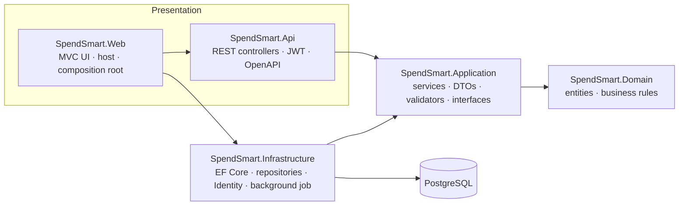

# SpendSmart

[](https://github.com/kritiiizz/SpendSmart/actions/workflows/ci.yml)


**A personal finance tracker: log expenses, set monthly budgets with alerts, and let recurring payments book themselves.**
Built with ASP.NET Core 10 using Clean Architecture, with a JWT-secured REST API and an MVC front end.

**Live demo:** https://&lt;your-app&gt;.azurewebsites.net — click **Try the demo**, or sign in with
`demo@spendsmart.dev` / `Demo1234!`
**API docs:** https://&lt;your-app&gt;.azurewebsites.net/swagger

<!-- Add screenshots to docs/screenshots and uncomment:

-->

## Features

- **Dashboard** with spending by category, a six-month trend (Chart.js), and month-over-month change. Aggregation runs in the database; results are cached per user and invalidated on every write.
- **Budgets with alerts.** Set a monthly limit per category; you're warned at 80% and flagged when you go over.
- **Recurring expenses.** Rent and subscriptions are generated by a background service. Schedules are drift-free (Jan 31 → Feb 28 → Mar 31), and a unique index makes double-booking impossible.
- **Expenses** with search, category and date filters, sortable columns and pagination.
- **Accounts** with ASP.NET Core Identity. Every query is scoped to the signed-in user; other users' data returns 404.
- **REST API** for everything, with JWT auth, Swagger UI, `ProblemDetails` errors and rate-limited login.

## Tech stack

| Area | Choices |
|---|---|
| Backend | ASP.NET Core 10 (MVC + Web API), C# 14 |
| Data | EF Core 10, PostgreSQL 17 (Npgsql), migrations |
| Auth | ASP.NET Core Identity (cookies for the UI), JWT bearer tokens (API) |
| Validation & errors | FluentValidation, RFC 9457 `ProblemDetails` via `IExceptionHandler` |
| Observability | Serilog structured logging (JSON in production), `/health` endpoint |
| Docs | OpenAPI (`Microsoft.AspNetCore.OpenApi`) + Swagger UI |
| Background work | `BackgroundService` with `PeriodicTimer` |
| Caching | `IMemoryCache` with per-user invalidation tokens |
| Front end | Razor views, Bootstrap 5, Chart.js |
| Tests | xUnit, NSubstitute, `WebApplicationFactory`, Testcontainers (real PostgreSQL) |
| DevOps | Docker, Docker Compose, GitHub Actions (CI, GHCR image, Azure deploy), Dependabot |

## Architecture



Dependencies point inward: `Domain` has no dependencies at all, and `Application` defines the interfaces
(`IExpenseRepository`, `ICurrentUser`, `IUnitOfWork`, …) that `Infrastructure` implements.

```
SpendSmart.sln
├── src/
│   ├── SpendSmart.Domain          Entities (Expense, Category, Budget, RecurringExpense) and their rules
│   ├── SpendSmart.Application     Use-case services, DTOs, FluentValidation, repository interfaces, caching
│   ├── SpendSmart.Infrastructure  DbContext, EF configurations, repositories, Identity, seeding, worker
│   ├── SpendSmart.Api             API controllers, JWT issuing/validation, exception handler, OpenAPI
│   └── SpendSmart.Web             MVC controllers & views, Program.cs (hosts the API too)
└── tests/
    ├── SpendSmart.UnitTests        Domain rules and services, with NSubstitute
    └── SpendSmart.IntegrationTests Full HTTP pipeline against PostgreSQL in Docker
```

The API lives in its own project but is hosted by `SpendSmart.Web`, so the demo is a single deployable
(UI at `/`, API at `/api`, docs at `/swagger`). Splitting it into a separate service later only means adding
a host project.

## Run it locally

### Option 1: Docker (one command)

```bash
docker compose up --build
```

Open http://localhost:8080 and click **Try the demo**. Swagger is at http://localhost:8080/swagger.

### Option 2: .NET SDK + Docker for the database

Requires the [.NET 10 SDK](https://dotnet.microsoft.com/download).

```bash
docker compose up -d db                 # PostgreSQL on localhost:5432
dotnet run --project src/SpendSmart.Web # http://localhost:5211
```

The Development settings (`appsettings.Development.json`) already point at that database and contain a
development-only JWT key. On startup the app applies migrations and seeds the demo account.

### Database migrations

```bash
./scripts/add-migration.sh InitialCreate   # wraps: dotnet ef migrations add … (uses the local tool manifest)
```

Commit the generated `src/SpendSmart.Infrastructure/Persistence/Migrations` folder. The app applies pending
migrations at startup. If the project has no migrations yet, it falls back to `EnsureCreated`, so the first
run works either way. After adding the first migration, recreate a database that was made by
`EnsureCreated` (`docker compose down -v`).

## Tests

```bash
dotnet test tests/SpendSmart.UnitTests          # fast, no dependencies
dotnet test tests/SpendSmart.IntegrationTests   # needs Docker (Testcontainers starts PostgreSQL)
```

- **Unit tests (79 cases)** cover the business rules: budget thresholds at exactly 80% and 100%, month-end
  and leap-year scheduling, recurring catch-up and idempotency, validators, service behaviour (ownership
  checks, cache invalidation), and dashboard aggregation.
- **Integration tests** run the real HTTP pipeline against PostgreSQL: auth (401 without a token, wrong
  password), user isolation (another user's expense is a 404), validation `ProblemDetails`, filtering and
  paging, budget alerts, cache invalidation, recurring booking, 409 conflicts, and health/OpenAPI endpoints.

## API

Interactive docs: **`/swagger`**. Call `POST /api/auth/login`, click **Authorize**, and paste the `accessToken`.

| Method | Endpoint | Description |
|---|---|---|
| POST | `/api/auth/register` | Create an account (gets default categories) and receive a JWT |
| POST | `/api/auth/login` | Exchange email and password for a JWT (rate-limited) |
| GET | `/api/expenses` | List with `categoryId`, `category`, `from`, `to`, `minAmount`, `maxAmount`, `search`, `sortBy`, `sortDirection`, `page`, `pageSize` |
| GET / POST | `/api/expenses/{id}` · `/api/expenses` | Read · create (201 + `Location`) |
| PUT / DELETE | `/api/expenses/{id}` | Update · delete (204) |
| GET / POST / PUT / DELETE | `/api/categories` | Manage categories (409 when deleting one in use) |
| GET / POST / PUT / DELETE | `/api/budgets` | Budgets with spending and status (`OnTrack` / `Warning` / `Exceeded`) |
| GET / POST / DELETE | `/api/recurring-expenses` | Recurring templates; `POST …/{id}/pause` and `…/{id}/resume` |
| GET | `/api/reports/dashboard?year=&month=` | Totals, category breakdown, six-month trend, budget alerts |

Example:

```http
GET /api/expenses?category=groceries&from=2026-01-01&sortBy=amount&page=2&pageSize=20
Authorization: Bearer eyJhbGciOi...
```

Errors use one shape everywhere:

```json
{
  "type": "https://tools.ietf.org/html/rfc9110#section-15.5.1",
  "title": "One or more validation errors occurred.",
  "status": 400,
  "errors": { "amount": ["Amount must be greater than zero."] },
  "traceId": "00-4bf92f3577b34da6a3ce929d0e0e4736-00f067aa0ba902b7-01"
}
```

## Design decisions

- **Ownership enforced in one place.** Every repository read takes the owner's id, and services get it from
  `ICurrentUser`. Requests for another user's data return 404 rather than 403, so ids can't be probed.
- **API uses JWT only, UI uses cookies only.** API endpoints never accept the cookie, so they can't be
  targeted by CSRF; every MVC POST is protected by `[AutoValidateAntiforgeryToken]`.
- **Validation in the application layer.** FluentValidation rules run in the services, so the API and the
  UI enforce identical rules. The UI also has data annotations, but only for instant client-side feedback.
- **Rich domain model.** Entities guard their own invariants (private setters, guard clauses), and the
  interesting rules (`Budget.Evaluate`, `RecurrenceSchedule.Next`) are pure functions that are easy to test.
- **Recurring jobs are idempotent.** Generated expenses and the advanced schedule are saved in one
  transaction, and a unique `(RecurringExpenseId, Date)` index is the backstop.
- **Cache invalidation with change tokens.** Each user's cached dashboards share a `CancellationTokenSource`,
  so one write evicts every cached month for that user. For multiple instances, swap `DashboardCache` for a
  Redis-backed `IDashboardCache`.
- **Configuration is resolved lazily** (options pattern, connection string read inside `AddDbContext`), which
  is what lets the integration tests point the app at a Testcontainers database.

## Deployment

The CI workflow builds and tests every push and pull request. On `main` it also pushes an image to GitHub
Container Registry and, once configured, deploys it to **Azure App Service**:

1. Create an Azure Database for PostgreSQL (Flexible Server) and a Linux Web App for Containers.
2. In the Web App's configuration, set:
   - `ConnectionStrings__Default`: your PostgreSQL connection string
   - `Jwt__SigningKey`: a random string of at least 32 characters
   - `WEBSITES_PORT`: `8080`
3. In GitHub, add the repository variable `AZURE_WEBAPP_NAME` and the secret `AZURE_WEBAPP_PUBLISH_PROFILE`
   (download it from the Web App's overview page).

The app refuses to start without a valid `Jwt__SigningKey`, so a misconfigured deployment fails immediately
instead of running insecurely. Render or Railway work the same way: deploy the `Dockerfile` and set the
same environment variables.

## Possible next steps

- CSV import of bank statements, with duplicate detection
- Redis-backed cache for multi-instance deployments
- Daily reset of the shared demo account
- Blazor or React front end consuming the existing API
